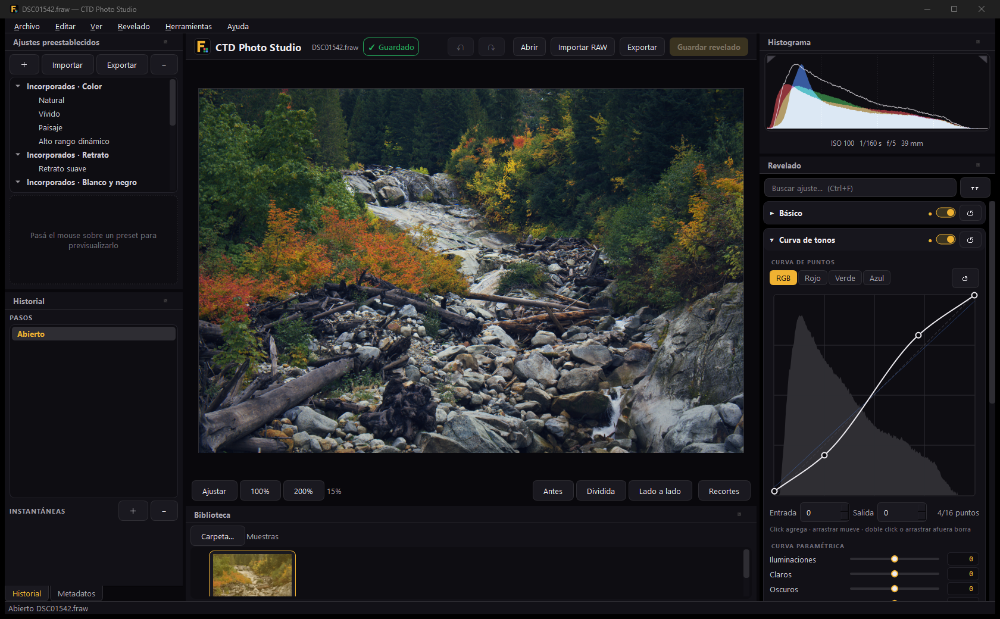

# FabriRAW (.fraw) · CTD Photo Studio

> 🤖 **Este proyecto fue hecho 100% por [Claude](https://claude.com/claude-code) (Anthropic).**
> FabriCTD escribió un único prompt inicial. El diseño del formato, la especificación, el código C++ y Python, los tests, la app de escritorio, el empaquetado, la web y esta documentación los hizo Claude, coordinando subagentes por hito y auditando cada entrega.
> La idea: mostrarle a fotógrafos y a quien sea lo que Claude puede construir.

**FabriRAW** es un formato RAW abierto para guardar el mosaico Bayer del sensor tal cual — sin interpolar y sin pérdida — con CRC-32 por bloque y el revelado no destructivo dentro del mismo archivo. **CTD Photo Studio** convierte tus `.CR3`, `.NEF`, `.ARW` (y otros RAW Bayer) a `.fraw` y los revela.

🌐 **Sitio:** https://fraw.fabrictd.com · 📦 **Descarga portable (Windows):** [CTD-Photo-Studio-Portable-win64.zip](https://github.com/FabriCTD/fabriraw/releases/latest/download/CTD-Photo-Studio-Portable-win64.zip) · 📐 **Spec:** [docs/SPEC.md](docs/SPEC.md)



## Qué incluye

| Módulo | Ruta | Qué hace |
|---|---|---|
| **Core C++20** | `core/` | `libfraw`: structs empaquetados (`#pragma pack`), `FRAWContainer`, `FRAWSet`, CRC-32, zlib, herramienta `fraw-info`. |
| **Paquete Python** | `python/fraw/` | Lector/escritor espejo del C++ (`format.py`, `fset.py`), ingesta con LibRaw/rawpy (`ingest.py`), motor de revelado (`processor.py`, `demosaic.py`, `devparams.py`). |
| **CLI** | `ctd-raw` | `ingest`, `burst`, `info`, `develop`, `dev`, `extract-thumb`, `verify`. |
| **GUI** | `ctd-studio` | Revelador profesional en PySide6: 107 ajustes en 10 categorías (slider + valor escribible), curvas, HSL, gradación de color, enfoque y ruido, óptica, recorte/enderezado/perspectiva, viñeta y grano, historial, presets, antes/después, aviso de recortes, estrellas y exportación por lotes. Todo no destructivo en el chunk `DEV `. |
| **Portable** | `packaging/` | PyInstaller onedir → `CTD-Photo-Studio-Portable-win64.zip` (CTDPhotoStudio.exe + ctd-raw.exe). |
| **Web** | `web/` | Landing estática de fraw.fabrictd.com (Netlify). |

## El formato en 30 segundos

```
46 52 41 57 0D 0A 1A 0A          "FRAW\r\n\x1a\n"
[HEAD][META][COLR][THMB][DATA][DEV ][END ]
cada chunk = id(4) flags(4) length(8) payload crc32(4)
```

* `HEAD` (64 B): geometría, CFA, niveles de negro/blanco, crop, orientación.
* `META`: JSON con cámara, lente, ISO, exposición…
* `COLR` (112 B): balance de blancos y matrices cámara→sRGB / XYZ→cámara.
* `THMB`: miniatura JPEG/RGB8. `DATA`: mosaico `u16` (opcionalmente zlib).
* `DEV `: parámetros de revelado en JSON (DEV v2: 107 ajustes, ver [docs/DEV_PARAMS.md](docs/DEV_PARAMS.md)) — editar sólo reescribe la cola del archivo.
* `.frw` = mismo formato con extensión corta; `.fset` = ráfaga de N `.fraw`.

Detalles normativos (offsets, errores, validaciones) en [docs/SPEC.md](docs/SPEC.md).

## Uso rápido

**Windows portable:** descargá el zip, descomprimí y abrí `CTDPhotoStudio.exe`. No requiere instalación.

**¿No tenés cámara RAW?** Bajá el [archivo de muestra](https://github.com/FabriCTD/fabriraw/releases/download/samples/FabriRAW-sample-SonyA6000.fraw) (Sony A6000, 30 MB, CC0 de raw.pixls.us, con un revelado de ejemplo en `DEV `) y abrilo con *Abrir*. En compactas Canon sin RAW (p. ej. PowerShot SX170 IS), el proyecto comunitario [CHDK](https://chdk.fandom.com/wiki/CHDK) permite guardar DNG, que `ctd-raw ingest` acepta (bajo tu responsabilidad).

**Con Python (3.10+):**

```bash
pip install "fabriraw[gui,ingest] @ git+https://github.com/FabriCTD/fabriraw#subdirectory=python"
ctd-raw ingest IMG_0001.CR3 -o foto.fraw
ctd-raw info foto.fraw
ctd-raw develop foto.fraw -o foto.jpg --ev +0.7 --wb daylight --set clarity=0.3 --auto-tone --long-edge 2048
ctd-studio
```

## Compilar y testear

```bash
# Core C++20 (GCC/Clang/MSVC, CMake ≥ 3.20)
cmake -S core -B core/build -DCMAKE_BUILD_TYPE=Release
cmake --build core/build --parallel
ctest --test-dir core/build --output-on-failure

# Python
pip install -e "python[dev,ingest,gui]"
cd python && python -m pytest -q

# Portable Windows
pip install pyinstaller
python packaging/build_portable.py
```

Estado en la v0.2.0: **ctest 13/13**, **pytest 531 passed**. El `golden.fraw` generado por C++ y por Python es idéntico byte a byte (SHA-256 `5e22137d…dda3e`), y la ingesta se verificó con RAW reales de Sony A6000 (ARW), Nikon D3200 (NEF) y Canon EOS M50 (CR3) de [raw.pixls.us](https://raw.pixls.us) (CC0).

## Cómo se hizo

1. Claude actuó como **Director de Proyecto**: escribió la especificación binaria (`docs/SPEC.md`) como contrato.
2. Delegó 5 hitos a subagentes: Core I/O C++/Python · Ingesta de cámara · Motor de revelado · CLI + GUI + exe · Landing web.
3. Auditó cada entrega (volcados hex contra la spec, tests cruzados C++↔Python, corrida de tests y del .exe real) antes de integrarla.

## Licencia

[MIT](LICENSE) © 2026 FabriCTD. Componentes de terceros (Qt/PySide6 LGPL-3.0, LibRaw LGPL-2.1/CDDL, NumPy, SciPy, Pillow, zlib…) en [THIRD_PARTY_NOTICES.md](THIRD_PARTY_NOTICES.md).
Canon, Nikon, Sony, Adobe y Claude/Anthropic son marcas de sus respectivos dueños; este proyecto no está afiliado a ellos.

---

[fabrictd.com](https://fabrictd.com) · GitHub [@FabriCTD](https://github.com/FabriCTD) · Discord `fabri.ctd`
